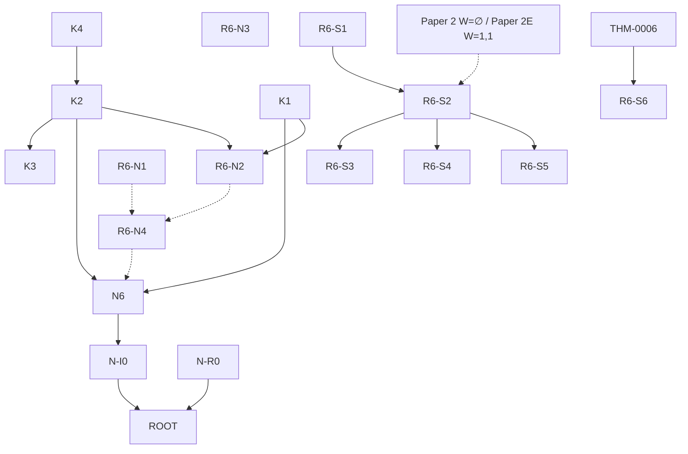

# PLAN_GRAPH：引理拆解 DAG

> 由 strategist 维护，总控每轮落盘。状态取值只有五种：`L0_CONJECTURE`、`L1_TESTED`、`L2_AUDITED`、`L3_FORMALIZED`、`REFUTED`。
> **全图同一时刻恰好有一个瓶颈标记**（即方括号包裹的 BOTTLENECK 字样，只出现在“当前主攻”一节）。边 `A --> B` 表示“A 被用于证明 B”；虚线 `A -.-> B` 表示“A 只为 B 提供证据或校准，不参与证明”。
> 既有结果的状态映射：仓库中经 CI 构建并通过公理门禁的结果记为 `L3_FORMALIZED`；只有纸面双检的记为 `L2_AUDITED`。

## 节点表

| ID | 命题（简述；R6 节点的精确陈述见下节） | 方向 | 状态 | 类别（AGENTS §2） | 依据 / 文件 |
|---|---|---|---|---|---|
| ROOT | 判定 $e+\pi\in\mathbb Q$ | — | `L0_CONJECTURE`（公开问题） | — | PROBLEM.md |
| N-I0 | 方向 I：$e+\pi\notin\mathbb Q$ | I | `L0_CONJECTURE` | — | — |
| N-R0 | 方向 R：存在 $a/b$ 使 $e+\pi=a/b$（Schanuel ⇒ 假） | R | `L0_CONJECTURE` | — | PROBLEM.md §0、B11；有限排除已饱和（D17） |
| K1 | P1 $\iff$ $\{1,e,\pi\}$ 在 $\mathbb Q$ 上线性无关（THM-0001） | I | `L3_FORMALIZED` | 3 | `RationalSpan.lean` |
| K2 | $\mathcal L$ 上的二分：$z\in\mathcal L\iff j\lVert Q_jz\rVert\to0$；否则 $\limsup\ge1/4$（THM-0003） | I | `L3_FORMALIZED` | 5 | `Classification.lean` |
| K3 | 常数 1/4 尖锐且可达（THM-0005） | I | `L3_FORMALIZED` | 1 的候选（仅负搜索） | `KappaSharp.lean` |
| K4 | $P_j/Q_j\to e$；$(e-1)/2=[0;1,6,10,\dots]$（R5 命题 9） | — | `L2_AUDITED`（Lean 只核了 (i)） | 5 | artifacts/THM-0005/paper_draft.tex |
| N6 | P1 核心：$\pi\notin\mathbb Q+\mathbb Qe$ | I | `L0_CONJECTURE` | — | R1–R4 盲攻 9 条路线均失败（D1–D8）；R6 判定受 B1/B16 阻挡 |
| R6-N1 | 度量 strip 律：未命中 strip $(j,B)$ 的 $x$ 测度 $\le4B^2/j$；几乎所有 $x$ 对每个 $B$ 都命中无穷多个 strip | Toy（度量） | `L0_CONJECTURE` | 待定（预期 5 或 1 的候选；新颖性未查） | 本文件 §R6 节点 |
| R6-N2 | LW 校准推论：$x\in\{e^{\sqrt2},\cos1\}$ 满足 $\forall B$：$Bx\notin\mathcal L$、$\limsup_j j\lVert BQ_jx\rVert\ge1/4$、阶乘数字不最终为常数 | Toy T1 | `L0_CONJECTURE` | 5（经典定理加项目结果的推论） | 本文件 §R6 节点 |
| R6-N3 | Nesterenko 对照：$e^\pi+\pi$ 超越（由 $\pi,e^\pi$ 代数无关推出） | Toy T2 | `L0_CONJECTURE`（文献结果，原文未核） | 5 | Paper 1 引 Nesterenko1996 |
| R6-N4 | $e$ 尺度通用性检验：π 的 $Q_j$ 尺度统计与已知答案对照、随机对照不可区分，并与 $r-e$ 对照可区分（有限范围；**以 Step 2 修正规格为准**） | Toy T1 / I（证据） | `L1_TESTED`（R6 Step 2 skeptic：MINOR_FIX，修正规格下 PASS） | 4 | 本文件 §R6 节点；原证伪测试见“当前主攻”中的历史记录 |
| R6-S1 | 块 Hurwitz 数的局部化引理：$\mathcal K_\alpha(\beta)<\infty$ 时，误差在大指标处趋于 0，块内误差由标签 $r_k\in\mathbb Z/K(W)$ 决定，KL 权重有显式极限 | 旁支（S） | `L0_CONJECTURE` | 5（预期） | 本文件 §R6 旁支轨 |
| R6-S2 | 块 Hurwitz 数的 KL 尖锐常数：$c^*(\alpha)=\nu(W)$（有限图上的极小极大值），且可达 | 旁支（S） | `L1_TESTED`（旁支 Step 2 skeptic：MINOR_FIX，修正规格下通过） | 1 的候选（仅本地负搜索） | 本文件 §R6 旁支轨；当前主攻 |
| R6-S3 | 非普适性：存在块词 $W$ 使 $\nu(W)<1$ | 旁支（S） | `L0_CONJECTURE` | 依赖 S2；具体 $\nu(W)$ 值为有限精确计算 | 本文件 §R6 旁支轨 |
| R6-S4 | $\inf_W\nu(W)=1/4$？（KL 常数 1/4 在块 Hurwitz 类中是否尖锐） | 旁支（S），开放 | `L0_CONJECTURE` | 若证出为 1 的候选 | 本文件 §R6 旁支轨 |
| R6-S5 | 经典 Hurwitz 常数推论：$c^*(e^{1/m})=c^*(\tanh(1/m))=c^*(\tan(1/m))=1$ | 旁支（S） | `L0_CONJECTURE` | 5 | 本文件 §R6 旁支轨 |
| R6-S6 | THM-0006 阈值 1 的尖锐与可达（设定对账；Paper 2 已在 $A_j\ge2$ 设定下陈述） | 旁支（S） | `L0_CONJECTURE` | 5（低优先级） | 本文件 §R6 旁支轨；D18 |

## R6 节点的精确陈述（R6 Step 1 strategist，2026-11-27）

记号：$Q_j$ 按 PROBLEM.md §1；$\lVert\cdot\rVert$ 为到最近整数的距离。对实数 $x$ 和正整数 $q$，“$q$ 是 $x$ 的收敛分母”指 $q$ 是 $x$ 的正则连分数某个收敛分数的分母。对整数 $B\ge1$ 和 $j>2B^2$，**strip** 定义为 $S(j,B):=[2BQ_j,\ jQ_j/B]$（Paper 1 thm:adaptive-strip）。若 $x$ 的某个收敛分母落在 $S(j,B)$ 中，就说 $x$ **命中** strip $(j,B)$。

- **R6-N1（Toy／度量，L0）**。(a) 对任意整数 $B\ge1$ 和 $j>2B^2$：$\lambda\{x\in[0,1):x\text{ 不命中 }S(j,B)\}\le4B^2/j$，其中 $\lambda$ 为 Lebesgue 测度。(b) 对 Lebesgue 几乎所有 $x$，对一切 $B\ge1$，$x$ 命中无穷多个 strip $(j,B)$。
  - 思路提示（不是证明）：若不命中，则存在收敛分母 $d<2BQ_j$，其下一个收敛分母 $>jQ_j/B$，于是 $\lVert dx\rVert<B/(jQ_j)$；对 $q<2BQ_j$ 做并集估计即得 (a)。(b) 由 (a) 与 $\limsup$ 事件的反向 Fatou 不等式得到。
  - 用途：给 R6-N4 的统计量 $S2$ 提供严格的参考上界。它**不涉及 π**。
- **R6-N2（Toy T1，L0）**。设 $x\in\{e^{\sqrt2},\cos1\}$，则对一切整数 $B\ge1$：(a) $Bx\notin\mathcal L$；(b) $\limsup_j j\lVert BQ_jx\rVert\ge1/4$；(c) 对一切 $k\in\mathbb Z$，$\limsup_n\lvert n\{n!x\}-k\rvert\ge1$，特别地 $x$ 的阶乘进制数字不最终为常数；(d) 把 π 换成 $x$ 后，$D_j(B)\ne0$ 对所有充分大的 $j$ 成立。
  - 推导链（不是证明）：Lindemann–Weierstrass（指数 $\{0,1,\sqrt2\}$ 或 $\{0,1,i,-i\}$）推出 $1,e,x$ 在 $\mathbb Q$ 上线性无关，由此得 $x\notin\mathbb Q+\mathbb Qe$；再分别用 prop:rational-span 与 K2 得 (a)(b)，用 Paper 1 thm:factorial-quantization 得 (c)，用 Escape.lean 的等价式（Paper 1 自报）得 (d)。
- **R6-N3（Toy T2，L0，文献）**。$\pi$ 与 $e^\pi$ 在 $\mathbb Q$ 上代数无关，因此 $e^\pi+\pi$ 超越。
  - 书目信息只来自 Paper 1 的 bibitem Nesterenko1996（Sb. Math. 187 (1996), 1319–1348），**原文页码与定理编号未核到**。本节点只用来标定“B1 在 Toy 中被什么桥接替代”，不连到 ROOT。
- **R6-N4（Toy T1 ／方向 I 证据，L0）**。取参数 $J=2000$、$N=4000$、$B_{\max}=30$、窗口 $W=(1000,2000]$、$W'=(2000,4000]$。定义
  - $E_j(B;x)=j\lVert BQ_jx\rVert$；
  - $H_j(B;x)=1$ 当且仅当 $x$ 命中 strip $(j,B)$（只对 $2B^2<1000$ 的 $B$ 计算）；
  - $\Phi_n(x)=\lfloor(n+1)\{n!\cdot(-x)\}\rfloor$。由 Paper 1 thm:factorial-quantization（取 $k=1$），$e+x\in\mathbb Q\iff\Phi_n(x)=1$ 最终成立；
  - $S1_B(x)=\#\{j\in W:E_j(B;x)<1/4\}$；
  - $S2_B(x)=\#\{j\in W:H_j(B;x)=0\}$；
  - $S3(x)=\#\{n\in W':\Phi_n(x)=1\}$；
  - $S4_B(x)$ 为 $\{BQ_jx\}$（$j\in W$）相对 $[0,1)$ 均匀分布的 Kolmogorov–Smirnov 统计量。

  **命题**：对 $x=\pi$，不出现硬签名 (r1)，也不出现软签名 (r2)（定义见“当前主攻”）。换言之，在上述有限范围内，π 的 $e$ 尺度统计与已知答案对照、随机参考集不可区分，并与 $r-e$ 阳性对照明显不同。若通过，属**类别 4**，只是证据。

## Toy Models（R6 Step 1）

| Toy | 替换 | 保留的困难 | 丢掉的困难 | Toy 中的结论 | 能否迁回原问题 |
|---|---|---|---|---|---|
| **T1（主）** | $\pi\to x\in\{e^{\sqrt2},\cos1\}$ | B13/B8：$x$ 的 CF 或稀疏尺度结构（就我们所知）同样未知（**负搜索未做**）；B14：同样只有测度型信息；问题形态相同（$x\notin\mathbb Q-e$？） | B1：$e$ 与 $x$ 同属 LW 的覆盖范围，即代数点处指数值的 $\overline{\mathbb Q}$-张成 | $x\notin\mathbb Q+\mathbb Qe$（LW），从而得到 R6-N2 的全部稀疏事实 | **不能**。π 不在 LW 框架内（B2、B4）。教训：B8/B13 完全保留时问题仍然可解，因此 B8 不是本质障碍，本质障碍是 B1（见 B17） |
| T2 | $e\to e^\pi$ | 指数型常数与 π 的加法关系问题；$e^\pi$ 的 CF 同样未知 | B1：模形式在 CM 点 $\tau=i$ 处给出桥接 | $e^\pi+\pi$ 超越（R6-N3，文献） | **不能**。$e$ 对应的 $\tau=i/(2\pi)$ 不是 CM 点（B18，D14） |
| T0（对照） | $\pi\to\log2$ 等其他周期 | B1 完整保留 | — | $e+\log2$ 的状态**未核到**，预期同样公开 | 保留 B1 的 Toy 不会更容易。本表据此只用“丢掉 B1”的 Toy 来定位障碍 |

## R6 路线（每条都附障碍通行证；拿不出通行证的路线未列入）

**路线 A：校准与 $e$ 尺度通用性检验（节点 R6-N1、R6-N2、R6-N4）**
- PASS(B13/B8)：不要求证明 π 的稀疏下界。稀疏事实只在已知答案的对照常数上**作为 LW 的推论**取得（N2），对 π 只做预注册的有限统计（N4）。
- PASS(B14)：不使用任何测度型输入。
- PASS(B16)：通过显式的 $r-e$ 阳性对照，检验统计量确实能把 π 与 $\mathbb Q-e$ 区分开（在有限范围内）。
- **不绕过 B1**：本路线不推进 ROOT。它的产出是战略校准（B17 的经验面）和类别 4 证据。

**路线 B：T2 障碍定位（节点 R6-N3，配合 D14）**
- PASS(B1)：仅在 Toy 中成立，靠 CM 桥接绕过；PASS(B4)：Nesterenko 方法不需要 E-函数。
- 对原问题不通行（B18）。产出是把 B1 的“缺口位置”精确到“非 CM 点处的两点联合超越次数下界”。

**NOT-REPEAT 逐条声明**

| Dn | 路线 A 与之差异 | 路线 B 与之差异 |
|---|---|---|
| D1 LW/HL | 不从 $e^{iS}=-e^{ie}$ 出发；LW 只用在对照常数 $x$ 上，不用在 π 上 | 不用 LW |
| D2 Baker | 不把 $e$ 写成对数 | 同左 |
| D3 Siegel–Shidlovskii | 不寻找取值 π 的 E-函数 | 同左 |
| D4 Nesterenko（π 三元组） | 不用 | D4 想从 $e+\pi\in\mathbb Q$ 导出矛盾；路线 B 只在 Toy 中**复现**已知结论，并明确记录迁移失败（D14），不再尝试导出矛盾 |
| D5 联合 Padé | 不构造逼近系统 | 同左 |
| D6 Schanuel(1,iπ) | 无条件，不引用猜想 | 同左 |
| D7 $Q_j$ 稀疏 limsup | 不尝试证明 $\limsup_j j\lVert BQ_j\pi\rVert>1/8$；对 π 只做有限统计，并加入 D7 没有的**已知答案对照** | 不用 |
| D8 格/Minkowski | 不重述线性无关 | 同左 |
| D9 阶乘窗口 | 不尝试证明 $\{n!\pi\}\le1/2$ 无穷多次；$S3$ 只作有限统计 | 不用 |
| D10 Niven 核 | 不用积分 | 同左 |
| D11 乘积分母 | 不组合收敛分数 | 同左 |
| D12 预期为假的条件 | 不以 $\operatorname{irr}(\pi)>2$ 等为目标 | 同左 |
| D13 逐项测度论证 | 不用测度上界 | 同左 |
| D14 一般 $q$ 的 Nesterenko | 不用 | 本身就是 D14 的记录方，不再重复推导 |
| D15 留数恒等式 | 不用 | 不用 |
| D16 Padé 填 strip | 不用 π 的 Padé 逼近，strip 只作统计量 | 不用 |
| D17 方向 R 有限排除 | 不扩大分母界。π 的统计在 $j\in(1000,2000]$、$B\le30$ 上做，并有 LW 对照与随机参考集，这是 Paper 1 的 $B\le20$、$j\le80$ 基线里没有的对照设计 | 不用 |

## R6 旁支轨（2026-11-27 R6 旁支 Step 1 strategist；依据 PROBLEM.md §4b）

> **旁支节点与 $e+\pi$ 的无理性无关**，不推进 ROOT、N6、P1。下文凡标“strategist 推导/手算”的内容都是纸面启发，**未经 skeptic 复核，未用代码验证，不得引用为结果**。凡标“作者自报 Lean”的内容，本轮**未复跑**（AGENTS.md §5）。

### S.0 候选方向去重（本地负搜索）

**检索范围**：仅限本仓库。包括 `paper2_spectral_gap_dimension/paper2_spectral_gap_dimension.tex` 的摘要与定理列表；spin-off 2E（`spinoff_full_convergent_and_even_hurwitz_20261125/`）的摘要、定理列表与 thm:full-spectra 全文；`epi_formal/EpiFormal/` 下 GeneralDichotomy、ThresholdAttained、KappaSharp、FullSpectrumDiscrete、FullConvergentSpectrum、SpectralGap、SignedClusters、DefectFibres、QuarterPoint*、GeneralGrowingRec/Dim、Golden*、GeneralEndpointRigidity 的声明与模块说明（grep）；`registry/results.csv`；Paper 1 中 Hurwitz / Komatsu 相关段落。**未做任何外部文献检索**（strategist 无联网工具）。

| 候选 | 结论 | 依据 |
|---|---|---|
| (a) 一般 $a_j\to\infty$ 下 THM-0006 阈值 1 是否尖锐 | **已被覆盖，不作为新目标。** Paper 2 thm:growing-rec-spectrum 对任意 $A_j\ge2$、$A_j\to\infty$ 的递推给出全谱 $\mathbb Z_{\ge0}\cup\{\infty\}$，可推出阈值 1 尖锐且可达（作者自报 Lean Layer A，未复跑）。只剩设定对账（THM-0006 允许 $a_j\ge1$、任意初值、格 $L_D$；Paper 2 用 $A_j\ge2$、格 $L_G$），记为 R6-S6，类别 5，低优先级 | Paper 2 摘要；`GeneralGrowingDim.lean`；D18 |
| (b) THM-0005 的极值集合 | **已被覆盖，不作为新目标。** Paper 2 thm:trichotomy 与 `FullSpectrumDiscrete.lean`（`unsigned_exact_limit_iff_defect_binary`、`signed_exact_limit_set_countable`、`dimH_signed_exact_limit_set_zero`）、`GaugeLiminfComplete.lean` 已经刻画：$\Lambda\le1/4\iff$ 缺陷最终取值于 $\{-1,0,1\}$；精确极限 $1/4\iff$ 缺陷最终取值于 $\{\pm1\}$；有符号极限集是 $L$ 的单个陪集；临界 gauge 与维数 0（均为作者自报 Lean，未复跑） | 同上；D18 |
| (c) R6-N1、R6-N2 | 保留 `L0_CONJECTURE`，旁支优先级**低**。N1 是初等并集估计（类别 5，可能经典，新颖性未查），Lean 可做但价值小。N2 是 LW 的直接推论（类别 5）；Lean 需要 Lindemann–Weierstrass，Mathlib 现状**未核到**，若改用项目 `Axioms.lean` 中声明的公理，则只能达到“项目自加公理”层级 | 本文件 §R6 节点 |
| (d) 沿**全部**收敛分母的 KL 尖锐常数，对象是“块 Hurwitz 型”α | **选为旁支主线（R6-S1…S5）。** 2E 只做了 $\alpha=e$（块词 $W=(1,1)$），Paper 2 只做了没有有界块（$W=\varnothing$）且用 $A_j$ 归一化的情形。一般块词 $W$ 的常数在仓库中未见 | 2E thm:full-spectra；本地 grep |

**潜在先例（未核到，阻碍类别 1 表述，见 B21）**：Paper 1 引用 Komatsu~1999（J. Théor. Nombres Bordeaux 11, 331–344；书目只来自 Paper 1 bibitem，原文未打开）研究 Hurwitz 型连分数的非齐次常数 $M(\theta,\phi)$。按 Paper 1 的转述，那是对**所有** $q$ 取的 $\liminf$ 型常数，而本支研究的是沿收敛分母、按 $\theta_n$ 归一化的 $\limsup$ 型常数。两者关系**未核到**。

### S.1 记号

- **连续子**：对有限词 $W=(w_1,\dots,w_\ell)\in\mathbb Z_{\ge1}^\ell$（$\ell\ge0$），$K()=1$，$K(w_1)=w_1$，$K(w_1,\dots,w_m)=w_mK(w_1,\dots,w_{m-1})+K(w_1,\dots,w_{m-2})$，并约定长度为 $-1$ 的连续子为 0。记 $K:=K(W)$；对 $1\le i\le\ell$，$c_i:=K(w_1,\dots,w_{i-1})$，$c_i':=K(w_{i+1},\dots,w_\ell)$。若 $\ell\ge1$，记 $\sigma:=c_\ell=K(w_1,\dots,w_{\ell-1})$（由行列式恒等式，$\gcd(\sigma,K)=1$）；若 $\ell=0$，则 $K=1$，$\sigma:=1$。
- $d_K(x):=\min_{s\in\mathbb Z}|x-sK|$（$x\in\mathbb Z$）。
- **块 Hurwitz 数**：$\alpha=[a_0;a_1,\dots,a_N,A_1,W,A_2,W,A_3,\dots]$，其中 $A_k\in\mathbb Z_{\ge1}$，$A_k\to\infty$，$W$ 是固定的有限词。**大指标** $n_k$ 由 $a_{n_k+1}=A_k$ 定义，于是 $n_{k+1}=n_k+\ell+1$。（多个块词周期交替的情形，如 $e^{2/m}$，记为扩展 S2′，本轮不立节点。）
- $p_n/q_n$ 为 α 的正则连分数收敛分数，$\theta_n:=q_n\lvert q_n\alpha-p_n\rvert$。**KL 泛函**：$\mathcal K_\alpha(\beta):=\limsup_n\lVert q_n\beta\rVert/\theta_n\in[0,\infty]$；**KL 尖锐常数**：$c^*(\alpha):=\inf_{\beta\notin\mathbb Z\alpha+\mathbb Z}\mathcal K_\alpha(\beta)$。
- **已知下界**：按 `artifacts/THM-0005/paper_draft.tex` 对 KL 1991 Thm 1 的引述（项目读过全文），$\beta\in\alpha\mathbb Z+\mathbb Z\iff$ 对充分大的 $n$ 有 $\lVert q_n\beta\rVert\le\theta_n/4$。因此对一切无理 α 都有 $c^*(\alpha)\ge1/4$。
- **局部图 $G_W$**：顶点集为 $\mathbb Z/K$。顶点代价 $v(r):=\max_{1\le i\le\ell}d_K(c_ir)/(c_ic_i')$（$\ell=0$ 时 $v\equiv0$）。从 $r$ 到 $r'$ 的边带一个实数 $t$，要求 $t\equiv(r'-\sigma r)/K\pmod 1$；边代价为 $\lvert t\rvert$。**平凡环**指顶点 0 处 $t=0$ 的自环。
- $\nu(W):=\min$，取遍所有**不全由平凡环组成**的有向闭路 $C$，被最小化的量是 $C$ 上顶点代价与边代价的最大值。因为顶点 0 处 $t=\pm1$ 的自环是非平凡闭路，所以 $\nu(W)\le1$。$\nu(W)$ 是一个有限的组合量：只需考虑 $\lvert t\rvert\le1$ 的边。

### S.2 节点的精确陈述（全部 `L0_CONJECTURE`；方向记为 S，表示旁支）

- **R6-S1（局部化引理；预期类别 5）**。设 α 是块 Hurwitz 数（块词 $W$），$\beta\in\mathbb R$，$\mathcal K_\alpha(\beta)<\infty$。记 $y_n:=q_n\beta-\operatorname{round}(q_n\beta)$，$t_k:=A_ky_{n_k}$。则：
  - (a) $y_{n_k}\to0$；$A_k\theta_{n_k}\to1$；对 $1\le i\le\ell$，$1/\theta_{n_k+i}\to K/(c_ic_i')$。
  - (b) 存在 $r_k\in\mathbb Z/K$（$k$ 充分大），使得对 $1\le i\le\ell$，$\lvert y_{n_k+i}\rvert-d_K(c_ir_k)/K\to0$；$(t_k)$ 有界，并且 $\operatorname{dist}\bigl(t_{k+1}-(r_{k+1}-\sigma r_k)/K,\ \mathbb Z\bigr)\to0$。
  - (c) $\beta\in\mathbb Z\alpha+\mathbb Z\iff$ 最终 $r_k=0$ 且 $t_k\to0$。
  - (d)（实现）对任意序列 $r_k\in\mathbb Z/K$ 和任意有界实数序列 $\tau_k\in(r_k-\sigma r_{k-1})/K+\mathbb Z$，存在 β，使其标签最终等于 $r_k$，且 $t_k-\tau_k\to0$。
  - 推导要点（strategist 推导，不是证明）：$\mathcal K<\infty$ 推出大指标处 $\lvert y\rvert\ll1/A_k\to0$。块内部分商有界，$y$ 满足带整数缺陷的正则连分数递推，于是 $y_{n_k+\ell+1}=K(W)\,y_{n_k+1}+O(y_{n_k})-(\text{整数})$，由此 $y_{n_k+1}\approx r_k/K$，并且 $y_{n_k+i}\equiv c_ir_k/K\pmod1$。KL 权重的极限由完全商与逆序连续子计算，再用连续子分裂恒等式 $K(W)=c_iK(w_i,\dots,w_\ell)+K(w_1,\dots,w_{i-2})c_i'$ 化简。技术上类似 THM-0006 (B) 与 2E thm:full-spectra 的证明。
- **R6-S2（KL 尖锐常数的极小极大公式；1 的候选；当前瓶颈，见“当前主攻”）**。对一切块 Hurwitz 数 α（单个块词 $W$，$A_k\to\infty$），$c^*(\alpha)=\nu(W)$，并且下确界可达：存在 $\beta\notin\mathbb Z\alpha+\mathbb Z$，使 $\mathcal K_\alpha(\beta)=\nu(W)$。特别地，$c^*(\alpha)$ 只依赖 $W$，与 $(A_k)$ 以及首段 $a_0,\dots,a_N$ 无关；并且 $1/4\le\nu(W)\le1$。
  - 校准（必须成立，否则 S1/S2 有错）：$\nu(\varnothing)=\nu((1))=\nu((1,1))=1$。$W=\varnothing$ 的情形对应 Paper 2 thm:growing-rec-spectrum（KL 比值与 $A_j\lVert Q_jx\rVert$ 等价），$W=(1,1)$ 的情形对应 2E thm:full-spectra(iii)（$\alpha=e$ 时初始谱隙为 $(0,1)$），两者都是作者自报 Lean，未复跑。
- **R6-S3（非普适性；依赖 S2；单个 $\nu(W)$ 是有限精确计算）**。存在块词 $W$ 使 $\nu(W)<1$。strategist 手算提示：$W=(5,1,5)$、$r=5$ 的零跳轨道 $\{r,\sigma r,\dots\}$ 上，顶点代价的最大值**可能** $<1$。这只是心算，**未用代码验证，不得引用**，交 skeptic 计算。若 S3 为假，即对一切 $W$ 都有 $\nu(W)=1$，则 S2 化为“在块 Hurwitz 类上 $c^*\equiv1$”，仍是 1 的候选，而且同样有意义。
- **R6-S4（开放问题；若证出为 1 的候选）**。$\inf_W\nu(W)=1/4$ 是否成立？若成立，则 KL 常数 $1/4$（limsup 形式）作为 $\inf_\alpha c^*(\alpha)$ 是尖锐的，并且由块 Hurwitz 数显式实现；若 $\inf_W\nu(W)>1/4$，则得到这一类上的一致改进。有限范围的最小值只是类别 4 证据，不能判定下确界。
- **R6-S5（经典常数推论；类别 5）**。若 S2 成立，则 $c^*(e^{1/m})=1$（$m\ge2$，$W=(1,1)$）、$c^*(\tanh(1/m))=1$（$W=\varnothing$）、$c^*(\tan(1/m))=1$（$W=(1)$）。所需的连分数展开中，$e^{1/m}=[1;\overline{(2k+1)m-1,1,1}]$ 只出自 Paper 1 的转述（原始出处**未核到**）；$\tanh(1/m)=[0;m,3m,5m,\dots]$ 与 $\tan(1/m)=[0;m-1,1,3m-2,1,5m-2,1,\dots]$ 的原始出处同样**未核到**，需要自证（可仿 R5 prop:input 的 Hermite 积分法）或核对原文后引用。
- **R6-S6（THM-0006 阈值 1 的尖锐性对账；类别 5；低优先级）**。在假设 (H) 下（$a_j\ge1$、$a_j\to\infty$、$D\ne0$）：存在 $z\notin L_D$ 使 $a_j\lVert Q_jz\rVert\to1$；并且 $\{\limsup_ja_j\lVert Q_jz\rVert:z\in\mathbb R\}=\mathbb Z_{\ge0}\cup\{\infty\}$。用途：关闭 `paper_draft.tex` 中“threshold 1 … not shown to be sharp”的备注，但必须注明 Paper 2 已在 $A_j\ge2$ 设定下陈述同一结论。Lean 方案：把 `ThresholdAttained.apprSeq_tendsto_of_defect_const` 与 KappaSharp 的构造推广到 `GeneralDichotomy.Data`。

### S.3 Toy / 校准

| Toy | 内容 | 用途 |
|---|---|---|
| T3（已知答案校准） | $W=\varnothing$（Paper 2）、$W=(1,1)$（2E，$\alpha=e$）、$W=(1)$（$\tan$ 型，strategist 推导预期为 1） | S2 的公式必须在这几种情形输出 1；不符则 S1/S2 有错，或者 2E/Paper 2 的自报结果有错，两者都要上报 |
| T4（边界） | 有界型 α（例如黄金比），没有大指标 | 不在 S1/S2 的范围内（B20）。Paper 1 §8 的黄金比常数（`GoldenOrbitRigidity.lean`）研究的泛函与 $\mathcal K_\alpha$ 的关系**未核到**，不得混用 |

### S.4 路线 C（旁支：块 Hurwitz 数的 KL 尖锐常数；节点 R6-S1→S2→S3/S4/S5，另有独立的 S6）

- PASS(B1): N/A（旁支，不连 ROOT）。
- PASS(B2–B7, B11, B13–B16, B18, B19): N/A。这些障碍只挡通往 ROOT/P1 的路线，路线 C 不涉及 π 或 $e+\pi$。
- PASS(B10): 路线 C 不是 ROOT 的等价改写，而是关于任意实数 β 的独立定理；对外不得写成“更接近 $e+\pi$”。
- PASS(B17): 不把 S 节点当作 π 的稀疏事实来源。它们对具体常数只有在已知 $\beta\notin\mathbb Z\alpha+\mathbb Z$ 时才有内容。
- PASS(B20): 只处理 $A_k\to\infty$ 且块词固定的情形。此时大指标处误差趋于 0，块内可以解耦。有界型 α 不在范围内。
- PASS(B21): 在 Komatsu 1999 与 Stewart 1981 全文核对之前，冻结“类别 1”的字样，对外只写“1 的候选，仅负搜索”。
- PASS(B22): Lean 目标是抽象的数字序列定理（只用连分数递推，不需要超越性输入，做法仿 `GeneralDichotomy`）。具体常数的推论 S5 延后处理。

| Dn | 路线 C 与之差异 |
|---|---|
| D1–D6、D8、D10–D16 | N/A：不涉及 π、ROOT 或 P1 的任何构造 |
| D7 $Q_j$ 稀疏 limsup | 不对 π 作任何 $Q_j$ 尺度断言；对象是任意 β 与块 Hurwitz 数 α |
| D9 阶乘窗口 | 不用 |
| D17 有限排除 | 不做分母排除；有限计算只用于证伪 S2 |
| D18 重做 (a)(b) | S2 研究的是沿**全部**收敛分母、对一般块词 $W$ 的 KL 常数，Paper 2 只覆盖 $W=\varnothing$，2E 只覆盖 $W=(1,1)$；(a)(b) 已覆盖的部分不重做，S6 明示只是对账 |

## 边

（R6-N3 是孤立的 Toy 节点，不连到 ROOT。R6-N4 → N6 是虚线：只提供证据，不参与证明。R6-S* 是旁支子图，**不连 ROOT、N6、P1**；CAL 是已知答案校准（作者自报 Lean，未复跑），只作虚线。R6-S4 除 S2 外还需要一族 $W$ 的渐近分析，这条边只表示依赖 S2。）

## 当前主攻

- `[BOTTLENECK]`：**R6-S2**（块 Hurwitz 数的 KL 尖锐常数公式 $c^*(\alpha)=\nu(W)$；方向：旁支 S；状态 `L1_TESTED`（旁支 Step 2）；2026-11-27 R6 旁支 Step 1 strategist 从 R6-N4 移交）。

**选择理由（Hardest-Case First）**
1. S2 是旁支主线的核心，同时承担 S1（局部化）与一个有限极小极大问题两部分风险。它一旦被证伪，S3、S4、S5 全部失去依据。
2. S2 **确实可能被证伪**，而且有三个独立的证伪口：(i) 若某个 $W$ 算出 $\nu(W)<1/4$，就与 KL 1991 Thm 1 冲突，说明局部化有错；(ii) 若 $\nu((1,1))\ne1$，就与 2E 的自报结果冲突；(iii) 若端到端数值中出现 $\mathcal K$ 低于 $\nu(W)$ 的 β，局部图就漏掉了约束。另外，strategist 手算提示，“$c^*\equiv1$”这一自然外推（来自 $e$ 与 $W=\varnothing$）可能对 $W=(5,1,5)$ 不成立（S3）。这正是最脆弱的地方。
3. 价值：若 S2 通过并被证出，它统一了 Paper 2（$W=\varnothing$）与 2E（$W=(1,1)$），给出 KL 常数依赖块结构的显式公式，并且可以在 Lean 中作为抽象数字序列定理形式化（不需要超越性输入）；具体 $W$ 的 $\nu(W)$ 可以用 `decide` 在有限数据上核验。若改用 `native_decide`，会引入额外的 `Lean.ofReduceBool` 依赖，需要在公理层级中单列。
4. 先验判断：S1 的局部化（预期类别 5）大概率成立。S2 的公式整体**风险中等**，最可能的失误是 $\nu$ 的定义漏掉了块间耦合约束。S3 的方向**不确定**。

**证伪测试（交给 skeptic，在 `experiments/R6-S2/` 中实现；strategist 未做任何数值计算）**
- **T1（精确有限计算，检验 $\nu$ 本身与校准）**
  - 范围 R1：$0\le\ell\le5$、各项取自 $\{1,\dots,5\}$ 的全部块词 $W$。范围 R2：$\ell\le10$、各项取自 $\{1,2\}$ 的全部块词。另加显式列表 $E=\{\varnothing,(1),(1,1),(2),(1,1,1),(2,3),(5,1,5)\}$。
  - 要算的量：对每个 $W$，按 S.1 的定义计算 $\nu(W)$。必须用精确有理算术（整数交叉相乘或 `fractions.Fraction`），并输出达到 $\nu(W)$ 的见证闭路。另外单独输出零跳部分 $\nu_0(W):=\min_{r\ne0}\max_{j\ge0}v(\sigma^jr)$。
  - 校准门槛 (g1)：$\nu(\varnothing)=\nu((1))=\nu((1,1))=1$，必须精确相等。若不成立，先审脚本（判 INVALID）；若脚本经审核无误，判 **REFUTED**，并把 2E 标为需要复审。
  - KL 门槛 (g2)：所有计算到的 $W$ 都要满足 $\nu(W)\ge1/4$（精确比较）。若有任何 $\nu(W)<1/4$，判 **REFUTED**。
- **T2（端到端：零跳闭路，独立于局部图模型）**
  - 对象：$W\in E\cup\{T1\text{ 在 }R1\cup R2\text{ 上的 argmin}\}$。构造 $\alpha_W:=[0;A_1,W,A_2,W,\dots]$，取 $A_k=10k$，$k\le45$。
  - 对全部 $(a,b)\in\{0,\dots,K-1\}^2\setminus\{(0,0)\}$，令 $\beta_{a,b}:=(a+b\alpha_W)/K$，计算 $R_n(a,b):=\lVert q_n\beta_{a,b}\rVert/\theta_n$，$n$ 取遍第 31–40 块（含大指标）。其中 $\lVert q_n\beta\rVert$ 用 $aq_n+bp_n$ 模 $K$ 的精确余数，再加 $b(q_n\alpha-p_n)/K$ 的修正。
  - “有限型”对：在第 31–40 块的所有大指标处都有 $aq_{n_k}+bp_{n_k}\equiv0\pmod K$。
  - 判定：令 $m_2(W):=\min$ 取遍有限型对的 $\max_nR_n(a,b)$。若 $\lvert m_2(W)-\nu_0(W)\rvert>0.02$，判 **REFUTED**。
- **T3（对抗搜索，独立于标签模型）**
  - 对同一组 $W$，用全序列缺陷递推 $n_{n+1}=a_{n+1}n_n+n_{n-1}+m_n$ 生成 β，取 $\beta:=n_N/q_N$，$N$ 为第 45 块末。缺陷 $m_n\in\{-2,\dots,2\}$，只允许出现在第 31–38 块。生成方式有两种：(i) 随机稀疏，密度取 0.02 和 0.1，各 5000 个样本；(ii) 局部搜索（爬山法），目标是最小化第 30–40 块上的 $\max_nR_n$，每个 $W$ 跑 200 次重启。
  - 判定：若某个缺陷不全为零的样本满足 $\max_nR_n<\nu(W)-0.02$，判 **REFUTED**。
- **精度**：工作精度取 $2\log_{10}q_{N+1}+100$ 位；再在 1.5 倍精度下全部重算，所有报告值必须一致到 $10^{-10}$，否则判 **INVALID**。
- **判 PASS**：(g1)(g2) 成立，T2、T3 都没有触发 REFUTED。此时 S2 升为 `L1_TESTED`，只是类别 4 证据。同时报告：$\nu$ 的完整表；全部 $\nu(W)<1$ 的 $W$（回答 S3 在有限范围内的情况）；范围内 $\nu$ 的最小值与 argmin（S4 的数据，不能判定下确界）。随后 prover 的任务是 S1 与 S2 的严格证明。
- **它没做到什么**：即便 PASS，也只是有限范围的证据，不是证明；不涉及 π 或 $e+\pi$；只覆盖单个块词（多词周期的扩展 S2′ 未覆盖，例如 $e^{2/m}$）；有界型 α 不在范围内；新颖性只做了本地负搜索，Komatsu 一系文献未读（B21）。

### 历史记录：R6-N4 主攻（R6 Step 1–2；2026-11-27 R6 旁支 Step 1 移交 R6-S2，N4 保留 `L1_TESTED`）

- 原瓶颈：**R6-N4**（$e$ 尺度通用性检验；方向：Toy T1 ／方向 I 证据；状态 `L1_TESTED`（Step 2））。以下为原选择理由与原证伪测试，仅作记录。

**选择理由（诚实说明）**
1. **本轮没有找到能绕过 B1 的路线。** 所有通向 ROOT 的节点（N6、N-I0）都被 B1/B16 挡住，而且无法用数值证伪。方向 R 的节点已被 Paper 1 的有限排除做到饱和（D17）。按 strategist.md 的字面标准（“最可能被证伪”），本轮**没有**既能推进 ROOT、又有实际证伪风险的节点。
2. 因此退而采用“失败代价最高”的原则：本轮的核心战略结论是 B17，即 B8 族路线被 B1 支配，π 在 $e$ 尺度上不带可利用的结构。R6-N4 是唯一一个一旦失败就会推翻这一结论的可检验节点。若 π 的统计显著偏离对照，就意味着 π 在 $e$ 尺度上有结构，D7/D9 以及方向 R 的启发式都必须重估。
3. **先验判断：预期通过**（不是因为它最可能被证伪才选它）。通过后只得到类别 4 证据，不推进 ROOT。
4. PASS(B13/B14/B16) 见路线 A；它不绕过 B1。

**证伪测试（交给 skeptic，在 `experiments/R6-N4/` 中实现；strategist 未做任何数值计算）**
- **对象**：π；LW 对照 $e^{\sqrt2}$、$\cos1$；代数对照 $\sqrt2$；阳性对照 $x_r=r-e$，$r\in\{6,\ 11/2,\ 17/3\}$（分母 $B_r=1,2,3$）；参考集 $\mathcal R$：400 个伪随机实数，在 $(3,4)$ 上均匀，用固定种子生成，种子写入脚本。
- **参数**：$J=2000$，$W=(1000,2000]$；$S1$、$S4$ 取 $B\in\{1,\dots,30\}$；$S2$ 只取满足 $2B^2<1000$ 的 $B$，具体列表由脚本输出；$N=4000$，$W'=(2000,4000]$。
- **要算的量**：对每个对象和每个 $B$，计算 $S1_B$、$S2_B$、$S3$、$S4_B$（定义见 R6-N4），以及 R6-N1 给出的参考上界 $\sum_{j\in W}4B^2/j$（由脚本计算）。
- **精度**：工作精度由脚本取 $\log_{10}(30\,Q_{J+1})$ 与 $\log_{10}((N+1)!)$ 中的较大者，再加 200 位保护位；然后在 1.5 倍精度下全部重算，所有整数统计量必须逐项一致，否则判 **INVALID**。
- **有效性门槛**（任一不满足即判 **INVALID**，此时不得判 REFUTED，应修脚本）：
  - (v1) 每个阳性对照 $x_r$ 都显示签名 (iii)；并且在 $B=B_r$ 及其不超过 30 的倍数上显示签名 (i)，在其中满足 $2B^2<1000$ 的 $B$ 上还显示签名 (ii)；
  - (v2) 先定义**留一出界计数**：对任一对象 $y$，$O(y)$ 是全部统计量（$S1_B,S2_B,S4_B$ 对所有适用的 $B$，再加 $S3$）中，$y$ 的取值严格落在 $\mathcal R\setminus\{y\}$ 的经验区间 $[\min,\max]$ 之外的个数。要求 $O(e^{\sqrt2})$、$O(\cos1)$、$O(\sqrt2)$ 都不超过 $\max_{y\in\mathcal R}O(y)$。这一门槛由参考集自身校准，阈值不预设数值。
- **判 REFUTED**（R6-N4 被击穿，回 Step 1，并把“π 在 $e$ 尺度上有结构”的线索交总控）：
  - (r1) 硬签名，任一出现即可：(i) 存在 $B\le30$，使 $E_j(B;\pi)<1/4$ 对 $W$ 中全部 $j$ 成立；(ii) 存在满足 $2B^2<1000$ 的 $B$，使 $H_j(B;\pi)=0$ 对 $W$ 中全部 $j$ 成立；(iii) $\Phi_n(\pi)=1$ 对 $W'$ 中全部 $n$ 成立。若出现 (r1)，必须先与 Paper 1 prop:farey-gap、prop:denominator-bounds 交叉核对；如有矛盾，优先怀疑脚本。
  - (r2) 软签名：$O(\pi)>\max_{y\in\mathcal R}O(y)$；或者 $S3(\pi)$ 严格落在 $\mathcal R$ 的经验 $[\min,\max]$ 之外，同时 $S3(\pi)$ 不小于该区间上端。后一条只针对“数字 1 过多”的方向，因为只有这个方向指向 $e+\pi\in\mathbb Q$。
- **判 PASS**：(v1)、(v2) 满足，且 (r1)、(r2) 都不出现。此时升级为 `L1_TESTED`，属类别 4。随后 prover 的任务是：给出 R6-N1、R6-N2 的严格证明，并把 N4 的硬签名部分写成区间算术证书。
- **它没做到什么**：即便通过，也只是有限范围的证据，对 $B>30$、$j>2000$ 都没有约束，也不推进 ROOT 或 N6。分母排除的强度远低于 Paper 1 已有的 $10^{500018}$，因此不得表述为新的有限排除成果。

## R6 Step 2 结果（skeptic，2026-11-27；证据：experiments/R6-N4/）

- **VERDICT: MINOR_FIX**。按原规格执行，结论为 INVALID，而且与 π 无关。最小修正后，(v1)(v2*) 均满足，(r1)(r2) 均未出现，判 PASS。节点**只升到 `L1_TESTED`**（类别 4）。
- **规格修正**（以下为现行规格）：
  1. **精度**：改为 $\max(\log_{10}(30Q_{J+1}),\log_{10}((N+1)!),2\log_{10}(JQ_J))+200$，实际为 14082 位；1.5 倍精度复核用 21123 位。原规格的 12877 位不足以把连分数可靠展开到 $JQ_J$。
  2. **(v2\*)**：把 $\sqrt2$ 从 (v2) 中移出，改作“有界部分商”对照。原因：当 $B\le14$ 时，$S2_B(\sqrt2)=0$ 是定理，因为 $q_{k+1}/q_k<2.5\le j/(2B^2)$，所以 (v2) 原本必然不满足。备选 (v2\*\*) 用 $2^{1/3}$ 代替 $\sqrt2$，同样 PASS，但 $2^{1/3}$ 的“通用性”只是猜想，因此以 v2\* 为准。
  3. **(r1)(ii) 的解释**：签名 (ii) 不专属于分母 $B$，只说明连分数是 Hurwitz 型或 $e$ 型，**不能**作为 $B(e+\pi)\in\mathbb Z$ 的证据。只有签名 (i) 专属于 $B$。
  4. **表述限定**：“不可区分”只对所选统计量成立。$S3$ 有盲区：$\cos1$ 在 $W'$ 上的阶乘数字全部属于 $\{0,n\}$，结构极强，但 $S3(\cos1)=0$ 仍落在参考区间内。
  5. **R6-N1 的适用范围**：参考上界 $\sum_{j\in W}4B^2/j$ 只在 $B\le18$ 时有意义；当 $B\ge19$ 时它超过 1000，失去约束力。
  6. **前提余量**：thm:adaptive-strip 的前提 $|Q_je-P_j|<1/(2jQ_j)$ 在 $W$ 上已逐项核过，但余量极小，$\max\log_{10}(2jQ_j|\delta_j|)=-0.0001$。之后任何引用都必须有对一切 $j$ 成立的严格证明。
- **π 的结果**：$O(\pi)=1$，唯一出界项为 $S2_9=163$，参考集最大值为 158；参考集 $\max O=6$；$S3(\pi)=2\in[0,4]$。$e^{\sqrt2}$、$\cos1$ 的 $O$ 都是 0。全部 83 个统计量在两种精度下逐项一致。
- **信息量（skeptic 评估）**：对方向 R、方向 I 都几乎为零。唯一产出是 B17 的经验校准：就所选统计量而言，π 在 $e$ 尺度上与随机数和 LW 对照无异。

## R6 旁支 Step 2 结果（skeptic，2026-11-27；证据：experiments/R6-S2/）

- **VERDICT: MINOR_FIX**。在有限范围内没有找到反例，与 KL 1991 Thm 1（转述见 THM-0005 note）、Paper 2、2E 都不冲突。R6-S2 升为 **`L1_TESTED`**（类别 4）。
- **规格修正**：
  - (M1) T3 的判据应为“$\beta\ne0$”，即 $N_N\ne0$，用精确整数判定。“缺陷不全为零”的写法会因为恒等式 $G_j=a_{j+2}G_{j+1}+G_{j+2}$ 产生假 REFUTED。
  - (M2) 新增 T2′：任意标签闭路的端到端实现，覆盖 $\nu<\nu_0$ 的跳跃闭路。T2 原本只检验零跳轨道。
  - (M3) T2 只在 $\sigma$ 轨道长度不超过窗口块数时有效。
  - (M4) 提示：g1 在 $K\le2$ 时几乎是空检验。
- **定义审查**：
  - $\nu$ 良定义，下确界可取到；
  - 取整平局 $d=K/2$ 不影响结果；
  - 块间耦合只有 $t_k\equiv(r_k-\sigma r_{k-1})/K\pmod1$；
  - 例外集合 $\beta\notin\mathbb Z\alpha+\mathbb Z$ 与 KL 的设定一致；
  - “可达”依赖 S1(d)。
- **数值（类别 4）**：
  - 在 5890 个词上精确计算 $\nu(W)$。其中 791 个（$K\le60$）用独立暴力算法交叉验证，0 处不符。
  - $\nu(5,1,5)=5/6$，**由代码确认**；有 5733/5890 个词满足 $\nu<1$。
  - 范围内最小值是 $12/17$，在 $W=(5,1,1,1,5)$ 处取得；扩展搜索的最小值约 $0.7016$。
  - $(w,1,w)$ 族给出 $\nu=w/(w+1)$（$w\ge3$）。
  - T2、T2′、T3 的端到端结果与 $\nu$ 吻合，偏差不超过 0.008，且随 $A$ 增大而缩小。
- **结构性发现（待 strategist 纳入 DAG）**：记 $m^*:=\min_{r\ne0}v(r)$。若 $m^*\ge1/2$，则 $\nu(W)=\min(1,m^*)$。范围内全部词都满足 $m^*\ge1/2$。若能**证明** $m^*\ge1/2$，则组合层面 $\inf_W\nu\ge1/2$；在 S2 成立的前提下，块 Hurwitz 类上一致有 $c^*\ge1/2>1/4$。

## R6 旁支 Step 4 记录（进行中）

- **R6-S7（$m^*\ge1/2$，由 prover 主动提出，尚未由 strategist 正式入图）**：proofs/R6-S7-mstar.md。
  - 隔离 skeptic 的结论是 **MINOR_FIX**：逐步论证成立；对 10950 个词做精确检验，0 处失败；对抗搜索得到的最小值为 $m^*=26/37\approx0.7027$。
  - 漏洞共 4 条：(L) 与分裂恒等式引用了未审的 R6-S2.md；$K=1$ 的情形未自证；闭路读法引用 (C3)；$\theta_n$ 的约定未写明。
  - 第 1/3 轮修补进行中。证据：experiments/R6-S2/audit_S7_check.py。
- **R6-S2**：隔离 skeptic 审计进行中（因会话中断而续跑）。

## 变更记录
- 2026-11-27：初版（R6 bootstrap，总控整理既有结果；不含新数学）。
- 2026-11-27（R6 Step 1 strategist）：新增节点 R6-N1…N4，全部为 `L0_CONJECTURE`；新增 Toy T0/T1/T2、路线 A/B 及其 PASS/NOT-REPEAT 声明；以 R6-N4 替换瓶颈占位说明，全图只保留一个瓶颈标记，并把文件头规则中的字面标记改写为文字描述，避免出现两个标记；N6、N-R0 的依据栏补注 B1/B16 与 D17；新增虚线边语义。本轮判断：没有能绕过 B1 的路线，瓶颈按“失败代价最高”选取，理由见“当前主攻”。
- 2026-11-27（R6 Step 2 总控落盘）：R6-N4 升为 `L1_TESTED`（修正规格下 PASS，类别 4），记录 6 项规格修正；瓶颈标记不变。
- 2026-11-27 R6 旁支 Step 1 strategist：依 PROBLEM.md §4b 开旁支轨。新增 §“R6 旁支轨”（候选去重表、记号、精确陈述、Toy T3/T4、路线 C 及其 PASS/NOT-REPEAT 声明），节点 R6-S1…S6 全部为 `L0_CONJECTURE`；节点表与 mermaid 加入旁支子图（不连 ROOT）。瓶颈标记由 R6-N4 移交 R6-S2，N4 保留 `L1_TESTED`，原理由与原证伪测试移入“历史记录”小节；全图仍只有一个瓶颈标记。去重结论：候选 (a)(b) 已被 Paper 2 / FullSpectrumDiscrete 等覆盖（作者自报 Lean，未复跑），记为 D18，只保留对账节点 S6。R6-N1、N2 降为低优先级。新颖性只做本地负搜索，未做外部检索。
- 2026-11-27（R6 旁支 Step 2 总控落盘）：R6-S2 升为 `L1_TESTED`；记录 M1–M4 与 $m^*\ge1/2$ 的结构性发现。
