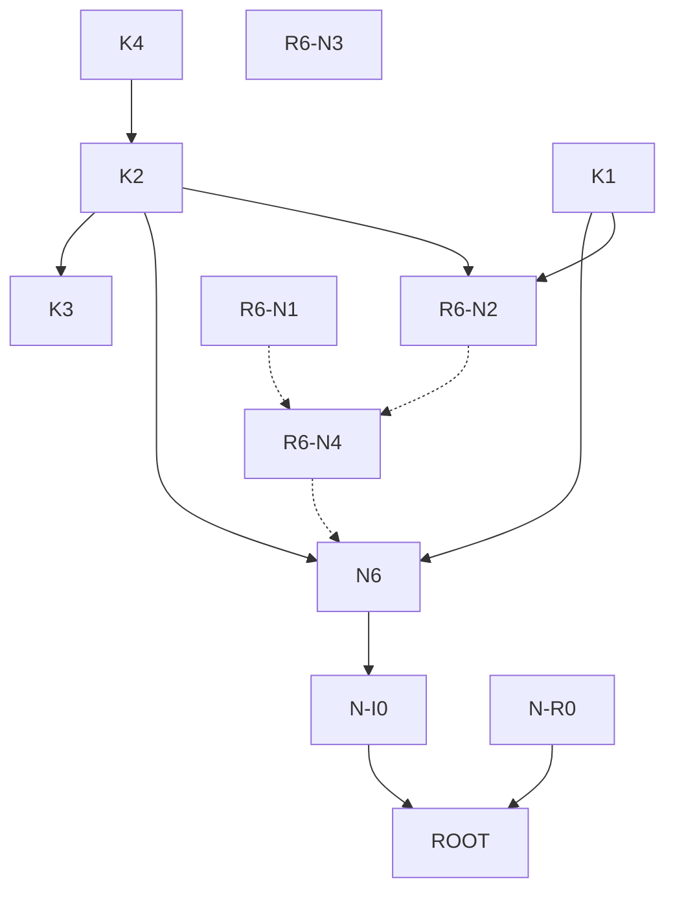

# PLAN_GRAPH：引理拆解 DAG

> 由 strategist 维护，总控每轮落盘。状态取值只有五种：`L0_CONJECTURE`、`L1_TESTED`、`L2_AUDITED`、`L3_FORMALIZED`、`REFUTED`。
> **全图同一时刻恰好有一个瓶颈标记**（即方括号包裹的 BOTTLENECK 字样，只出现在“当前主攻”一节）。边 `A --> B` 表示“A 被用于证明 B”；虚线 `A -.-> B` 表示“A 只为 B 提供证据或校准，不参与证明”。
> 既有结果的状态映射：仓库中经 CI 构建并通过公理门禁的结果记为 `L3_FORMALIZED`；只有纸面双检的记为 `L2_AUDITED`。

## 节点表

| ID | 命题（简述；R6 节点的精确陈述见下节） | 方向 | 状态 | 类别（AGENTS §2） | 依据 / 文件 |
|---|---|---|---|---|---|
| ROOT | 判定 $e+\pi\in\mathbb Q$ | — | `L0_CONJECTURE`（公开问题） | — | PROBLEM.md |
| N-I0 | 方向 I：$e+\pi\notin\mathbb Q$ | I | `L0_CONJECTURE` | — | — |
| N-R0 | 方向 R：存在 $a/b$ 使 $e+\pi=a/b$（Schanuel ⇒ 假） | R | `L0_CONJECTURE` | — | PROBLEM.md §0、B11；有限排除已饱和（D17） |
| K1 | P1 $\iff$ $\{1,e,\pi\}$ 在 $\mathbb Q$ 上线性无关（THM-0001） | I | `L3_FORMALIZED` | 3 | `RationalSpan.lean` |
| K2 | $\mathcal L$ 上的二分：$z\in\mathcal L\iff j\lVert Q_jz\rVert\to0$；否则 $\limsup\ge1/4$（THM-0003） | I | `L3_FORMALIZED` | 5 | `Classification.lean` |
| K3 | 常数 1/4 尖锐且可达（THM-0005） | I | `L3_FORMALIZED` | 1 的候选（仅负搜索） | `KappaSharp.lean` |
| K4 | $P_j/Q_j\to e$；$(e-1)/2=[0;1,6,10,\dots]$（R5 命题 9） | — | `L2_AUDITED`（Lean 只核了 (i)） | 5 | artifacts/THM-0005/paper_draft.tex |
| N6 | P1 核心：$\pi\notin\mathbb Q+\mathbb Qe$ | I | `L0_CONJECTURE` | — | R1–R4 盲攻 9 条路线均失败（D1–D8）；R6 判定受 B1/B16 阻挡 |
| R6-N1 | 度量 strip 律：未命中 strip $(j,B)$ 的 $x$ 测度 $\le4B^2/j$；几乎所有 $x$ 对每个 $B$ 都命中无穷多个 strip | Toy（度量） | `L0_CONJECTURE` | 待定（预期 5 或 1 的候选；新颖性未查） | 本文件 §R6 节点 |
| R6-N2 | LW 校准推论：$x\in\{e^{\sqrt2},\cos1\}$ 满足 $\forall B$：$Bx\notin\mathcal L$、$\limsup_j j\lVert BQ_jx\rVert\ge1/4$、阶乘数字不最终为常数 | Toy T1 | `L0_CONJECTURE` | 5（经典定理加项目结果的推论） | 本文件 §R6 节点 |
| R6-N3 | Nesterenko 对照：$e^\pi+\pi$ 超越（由 $\pi,e^\pi$ 代数无关推出） | Toy T2 | `L0_CONJECTURE`（文献结果，原文未核） | 5 | Paper 1 引 Nesterenko1996 |
| R6-N4 | $e$ 尺度通用性检验：π 的 $Q_j$ 尺度统计与已知答案对照、随机对照不可区分，并与 $r-e$ 对照可区分（有限范围） | Toy T1 / I（证据） | `L0_CONJECTURE` | 若通过：4 | 本文件 §R6 节点；证伪测试见“当前主攻” |

## R6 节点的精确陈述（R6 Step 1 strategist，2026-11-27）

记号：$Q_j$ 按 PROBLEM.md §1；$\lVert\cdot\rVert$ 为到最近整数的距离。对实数 $x$ 和正整数 $q$，“$q$ 是 $x$ 的收敛分母”指 $q$ 是 $x$ 的正则连分数某个收敛分数的分母。对整数 $B\ge1$ 和 $j>2B^2$，**strip** 定义为 $S(j,B):=[2BQ_j,\ jQ_j/B]$（Paper 1 thm:adaptive-strip）。若 $x$ 的某个收敛分母落在 $S(j,B)$ 中，就说 $x$ **命中** strip $(j,B)$。

- **R6-N1（Toy／度量，L0）**。(a) 对任意整数 $B\ge1$ 和 $j>2B^2$：$\lambda\{x\in[0,1):x\text{ 不命中 }S(j,B)\}\le4B^2/j$，其中 $\lambda$ 为 Lebesgue 测度。(b) 对 Lebesgue 几乎所有 $x$，对一切 $B\ge1$，$x$ 命中无穷多个 strip $(j,B)$。
  - 思路提示（不是证明）：若不命中，则存在收敛分母 $d<2BQ_j$，其下一个收敛分母 $>jQ_j/B$，于是 $\lVert dx\rVert<B/(jQ_j)$；对 $q<2BQ_j$ 做并集估计即得 (a)。(b) 由 (a) 与 $\limsup$ 事件的反向 Fatou 不等式得到。
  - 用途：给 R6-N4 的统计量 $S2$ 提供严格的参考上界。它**不涉及 π**。
- **R6-N2（Toy T1，L0）**。设 $x\in\{e^{\sqrt2},\cos1\}$，则对一切整数 $B\ge1$：(a) $Bx\notin\mathcal L$；(b) $\limsup_j j\lVert BQ_jx\rVert\ge1/4$；(c) 对一切 $k\in\mathbb Z$，$\limsup_n\lvert n\{n!x\}-k\rvert\ge1$，特别地 $x$ 的阶乘进制数字不最终为常数；(d) 把 π 换成 $x$ 后，$D_j(B)\ne0$ 对所有充分大的 $j$ 成立。
  - 推导链（不是证明）：Lindemann–Weierstrass（指数 $\{0,1,\sqrt2\}$ 或 $\{0,1,i,-i\}$）推出 $1,e,x$ 在 $\mathbb Q$ 上线性无关，由此得 $x\notin\mathbb Q+\mathbb Qe$；再分别用 prop:rational-span 与 K2 得 (a)(b)，用 Paper 1 thm:factorial-quantization 得 (c)，用 Escape.lean 的等价式（Paper 1 自报）得 (d)。
- **R6-N3（Toy T2，L0，文献）**。$\pi$ 与 $e^\pi$ 在 $\mathbb Q$ 上代数无关，因此 $e^\pi+\pi$ 超越。
  - 书目信息只来自 Paper 1 的 bibitem Nesterenko1996（Sb. Math. 187 (1996), 1319–1348），**原文页码与定理编号未核到**。本节点只用来标定“B1 在 Toy 中被什么桥接替代”，不连到 ROOT。
- **R6-N4（Toy T1 ／方向 I 证据，L0）**。取参数 $J=2000$、$N=4000$、$B_{\max}=30$、窗口 $W=(1000,2000]$、$W'=(2000,4000]$。定义
  - $E_j(B;x)=j\lVert BQ_jx\rVert$；
  - $H_j(B;x)=1$ 当且仅当 $x$ 命中 strip $(j,B)$（只对 $2B^2<1000$ 的 $B$ 计算）；
  - $\Phi_n(x)=\lfloor(n+1)\{n!\cdot(-x)\}\rfloor$。由 Paper 1 thm:factorial-quantization（取 $k=1$），$e+x\in\mathbb Q\iff\Phi_n(x)=1$ 最终成立；
  - $S1_B(x)=\#\{j\in W:E_j(B;x)<1/4\}$；
  - $S2_B(x)=\#\{j\in W:H_j(B;x)=0\}$；
  - $S3(x)=\#\{n\in W':\Phi_n(x)=1\}$；
  - $S4_B(x)$ 为 $\{BQ_jx\}$（$j\in W$）相对 $[0,1)$ 均匀分布的 Kolmogorov–Smirnov 统计量。

  **命题**：对 $x=\pi$，不出现硬签名 (r1)，也不出现软签名 (r2)（定义见“当前主攻”）。换言之，在上述有限范围内，π 的 $e$ 尺度统计与已知答案对照、随机参考集不可区分，并与 $r-e$ 阳性对照明显不同。若通过，属**类别 4**，只是证据。

## Toy Models（R6 Step 1）

| Toy | 替换 | 保留的困难 | 丢掉的困难 | Toy 中的结论 | 能否迁回原问题 |
|---|---|---|---|---|---|
| **T1（主）** | $\pi\to x\in\{e^{\sqrt2},\cos1\}$ | B13/B8：$x$ 的 CF 或稀疏尺度结构（就我们所知）同样未知（**负搜索未做**）；B14：同样只有测度型信息；问题形态相同（$x\notin\mathbb Q-e$？） | B1：$e$ 与 $x$ 同属 LW 的覆盖范围，即代数点处指数值的 $\overline{\mathbb Q}$-张成 | $x\notin\mathbb Q+\mathbb Qe$（LW），从而得到 R6-N2 的全部稀疏事实 | **不能**。π 不在 LW 框架内（B2、B4）。教训：B8/B13 完全保留时问题仍然可解，因此 B8 不是本质障碍，本质障碍是 B1（见 B17） |
| T2 | $e\to e^\pi$ | 指数型常数与 π 的加法关系问题；$e^\pi$ 的 CF 同样未知 | B1：模形式在 CM 点 $\tau=i$ 处给出桥接 | $e^\pi+\pi$ 超越（R6-N3，文献） | **不能**。$e$ 对应的 $\tau=i/(2\pi)$ 不是 CM 点（B18，D14） |
| T0（对照） | $\pi\to\log2$ 等其他周期 | B1 完整保留 | — | $e+\log2$ 的状态**未核到**，预期同样公开 | 保留 B1 的 Toy 不会更容易。本表据此只用“丢掉 B1”的 Toy 来定位障碍 |

## R6 路线（每条都附障碍通行证；拿不出通行证的路线未列入）

**路线 A：校准与 $e$ 尺度通用性检验（节点 R6-N1、R6-N2、R6-N4）**
- PASS(B13/B8)：不要求证明 π 的稀疏下界。稀疏事实只在已知答案的对照常数上**作为 LW 的推论**取得（N2），对 π 只做预注册的有限统计（N4）。
- PASS(B14)：不使用任何测度型输入。
- PASS(B16)：通过显式的 $r-e$ 阳性对照，检验统计量确实能把 π 与 $\mathbb Q-e$ 区分开（在有限范围内）。
- **不绕过 B1**：本路线不推进 ROOT。它的产出是战略校准（B17 的经验面）和类别 4 证据。

**路线 B：T2 障碍定位（节点 R6-N3，配合 D14）**
- PASS(B1)：仅在 Toy 中成立，靠 CM 桥接绕过；PASS(B4)：Nesterenko 方法不需要 E-函数。
- 对原问题不通行（B18）。产出是把 B1 的“缺口位置”精确到“非 CM 点处的两点联合超越次数下界”。

**NOT-REPEAT 逐条声明**

| Dn | 路线 A 与之差异 | 路线 B 与之差异 |
|---|---|---|
| D1 LW/HL | 不从 $e^{iS}=-e^{ie}$ 出发；LW 只用在对照常数 $x$ 上，不用在 π 上 | 不用 LW |
| D2 Baker | 不把 $e$ 写成对数 | 同左 |
| D3 Siegel–Shidlovskii | 不寻找取值 π 的 E-函数 | 同左 |
| D4 Nesterenko（π 三元组） | 不用 | D4 想从 $e+\pi\in\mathbb Q$ 导出矛盾；路线 B 只在 Toy 中**复现**已知结论，并明确记录迁移失败（D14），不再尝试导出矛盾 |
| D5 联合 Padé | 不构造逼近系统 | 同左 |
| D6 Schanuel(1,iπ) | 无条件，不引用猜想 | 同左 |
| D7 $Q_j$ 稀疏 limsup | 不尝试证明 $\limsup_j j\lVert BQ_j\pi\rVert>1/8$；对 π 只做有限统计，并加入 D7 没有的**已知答案对照** | 不用 |
| D8 格/Minkowski | 不重述线性无关 | 同左 |
| D9 阶乘窗口 | 不尝试证明 $\{n!\pi\}\le1/2$ 无穷多次；$S3$ 只作有限统计 | 不用 |
| D10 Niven 核 | 不用积分 | 同左 |
| D11 乘积分母 | 不组合收敛分数 | 同左 |
| D12 预期为假的条件 | 不以 $\operatorname{irr}(\pi)>2$ 等为目标 | 同左 |
| D13 逐项测度论证 | 不用测度上界 | 同左 |
| D14 一般 $q$ 的 Nesterenko | 不用 | 本身就是 D14 的记录方，不再重复推导 |
| D15 留数恒等式 | 不用 | 不用 |
| D16 Padé 填 strip | 不用 π 的 Padé 逼近，strip 只作统计量 | 不用 |
| D17 方向 R 有限排除 | 不扩大分母界。π 的统计在 $j\in(1000,2000]$、$B\le30$ 上做，并有 LW 对照与随机参考集，这是 Paper 1 的 $B\le20$、$j\le80$ 基线里没有的对照设计 | 不用 |

## 边

（R6-N3 是孤立的 Toy 节点，不连到 ROOT。R6-N4 → N6 是虚线：只提供证据，不参与证明。）

## 当前主攻

- `[BOTTLENECK]`：**R6-N4**（$e$ 尺度通用性检验；方向：Toy T1 ／方向 I 证据；状态 `L0_CONJECTURE`）。

**选择理由（诚实说明）**
1. **本轮没有找到能绕过 B1 的路线。** 所有通向 ROOT 的节点（N6、N-I0）都被 B1/B16 挡住，而且无法用数值证伪。方向 R 的节点已被 Paper 1 的有限排除做到饱和（D17）。按 strategist.md 的字面标准（“最可能被证伪”），本轮**没有**既能推进 ROOT、又有实际证伪风险的节点。
2. 因此退而采用“失败代价最高”的原则：本轮的核心战略结论是 B17，即 B8 族路线被 B1 支配，π 在 $e$ 尺度上不带可利用的结构。R6-N4 是唯一一个一旦失败就会推翻这一结论的可检验节点。若 π 的统计显著偏离对照，就意味着 π 在 $e$ 尺度上有结构，D7/D9 以及方向 R 的启发式都必须重估。
3. **先验判断：预期通过**（不是因为它最可能被证伪才选它）。通过后只得到类别 4 证据，不推进 ROOT。
4. PASS(B13/B14/B16) 见路线 A；它不绕过 B1。

**证伪测试（交给 skeptic，在 `experiments/R6-N4/` 中实现；strategist 未做任何数值计算）**
- **对象**：π；LW 对照 $e^{\sqrt2}$、$\cos1$；代数对照 $\sqrt2$；阳性对照 $x_r=r-e$，$r\in\{6,\ 11/2,\ 17/3\}$（分母 $B_r=1,2,3$）；参考集 $\mathcal R$：400 个伪随机实数，在 $(3,4)$ 上均匀，用固定种子生成，种子写入脚本。
- **参数**：$J=2000$，$W=(1000,2000]$；$S1$、$S4$ 取 $B\in\{1,\dots,30\}$；$S2$ 只取满足 $2B^2<1000$ 的 $B$，具体列表由脚本输出；$N=4000$，$W'=(2000,4000]$。
- **要算的量**：对每个对象和每个 $B$，计算 $S1_B$、$S2_B$、$S3$、$S4_B$（定义见 R6-N4），以及 R6-N1 给出的参考上界 $\sum_{j\in W}4B^2/j$（由脚本计算）。
- **精度**：工作精度由脚本取 $\log_{10}(30\,Q_{J+1})$ 与 $\log_{10}((N+1)!)$ 中的较大者，再加 200 位保护位；然后在 1.5 倍精度下全部重算，所有整数统计量必须逐项一致，否则判 **INVALID**。
- **有效性门槛**（任一不满足即判 **INVALID**，此时不得判 REFUTED，应修脚本）：
  - (v1) 每个阳性对照 $x_r$ 都显示签名 (iii)；并且在 $B=B_r$ 及其不超过 30 的倍数上显示签名 (i)，在其中满足 $2B^2<1000$ 的 $B$ 上还显示签名 (ii)；
  - (v2) 先定义**留一出界计数**：对任一对象 $y$，$O(y)$ 是全部统计量（$S1_B,S2_B,S4_B$ 对所有适用的 $B$，再加 $S3$）中，$y$ 的取值严格落在 $\mathcal R\setminus\{y\}$ 的经验区间 $[\min,\max]$ 之外的个数。要求 $O(e^{\sqrt2})$、$O(\cos1)$、$O(\sqrt2)$ 都不超过 $\max_{y\in\mathcal R}O(y)$。这一门槛由参考集自身校准，阈值不预设数值。
- **判 REFUTED**（R6-N4 被击穿，回 Step 1，并把“π 在 $e$ 尺度上有结构”的线索交总控）：
  - (r1) 硬签名，任一出现即可：(i) 存在 $B\le30$，使 $E_j(B;\pi)<1/4$ 对 $W$ 中全部 $j$ 成立；(ii) 存在满足 $2B^2<1000$ 的 $B$，使 $H_j(B;\pi)=0$ 对 $W$ 中全部 $j$ 成立；(iii) $\Phi_n(\pi)=1$ 对 $W'$ 中全部 $n$ 成立。若出现 (r1)，必须先与 Paper 1 prop:farey-gap、prop:denominator-bounds 交叉核对；如有矛盾，优先怀疑脚本。
  - (r2) 软签名：$O(\pi)>\max_{y\in\mathcal R}O(y)$；或者 $S3(\pi)$ 严格落在 $\mathcal R$ 的经验 $[\min,\max]$ 之外，同时 $S3(\pi)$ 不小于该区间上端。后一条只针对“数字 1 过多”的方向，因为只有这个方向指向 $e+\pi\in\mathbb Q$。
- **判 PASS**：(v1)、(v2) 满足，且 (r1)、(r2) 都不出现。此时升级为 `L1_TESTED`，属类别 4。随后 prover 的任务是：给出 R6-N1、R6-N2 的严格证明，并把 N4 的硬签名部分写成区间算术证书。
- **它没做到什么**：即便通过，也只是有限范围的证据，对 $B>30$、$j>2000$ 都没有约束，也不推进 ROOT 或 N6。分母排除的强度远低于 Paper 1 已有的 $10^{500018}$，因此不得表述为新的有限排除成果。

## 变更记录
- 2026-11-27：初版（R6 bootstrap，总控整理既有结果；不含新数学）。
- 2026-11-27（R6 Step 1 strategist）：新增节点 R6-N1…N4，全部为 `L0_CONJECTURE`；新增 Toy T0/T1/T2、路线 A/B 及其 PASS/NOT-REPEAT 声明；以 R6-N4 替换瓶颈占位说明，全图只保留一个瓶颈标记，并把文件头规则中的字面标记改写为文字描述，避免出现两个标记；N6、N-R0 的依据栏补注 B1/B16 与 D17；新增虚线边语义。本轮判断：没有能绕过 B1 的路线，瓶颈按“失败代价最高”选取，理由见“当前主攻”。
