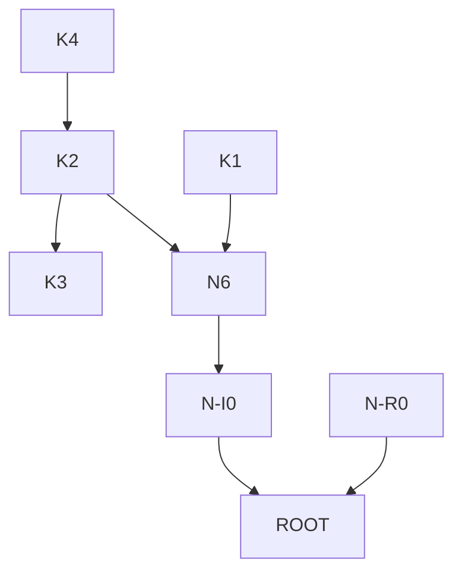

# PLAN_GRAPH：引理拆解 DAG

> 由 strategist 维护，总控每轮落盘。状态取值只有五种：`L0_CONJECTURE`、`L1_TESTED`、`L2_AUDITED`、`L3_FORMALIZED`、`REFUTED`。
> **全图同一时刻恰好有一个 `[BOTTLENECK]`**。边 `A --> B` 表示“A 被用于证明 B”。
> 既有结果的状态映射：仓库中经 CI 构建并通过公理门禁的结果记为 `L3_FORMALIZED`；只有纸面双检的记为 `L2_AUDITED`。

## 节点表

| ID | 命题 | 方向 | 状态 | 类别（AGENTS §2） | 依据 / 文件 |
|---|---|---|---|---|---|
| ROOT | 判定 $e+\pi\in\mathbb Q$ | — | `L0_CONJECTURE`（公开问题） | — | PROBLEM.md |
| N-I0 | 方向 I：$e+\pi\notin\mathbb Q$ | I | `L0_CONJECTURE` | — | — |
| N-R0 | 方向 R：存在 $a/b$ 使 $e+\pi=a/b$（Schanuel ⇒ 假） | R | `L0_CONJECTURE` | — | PROBLEM.md §0、B11 |
| K1 | P1 $\iff$ $\{1,e,\pi\}$ 在 $\mathbb Q$ 上线性无关（THM-0001） | I | `L3_FORMALIZED` | 3 | `RationalSpan.lean` |
| K2 | $\mathcal L$ 上的二分：$z\in\mathcal L\iff j\lVert Q_jz\rVert\to0$；否则 $\limsup\ge1/4$（THM-0003） | I | `L3_FORMALIZED` | 5 | `Classification.lean` |
| K3 | 常数 1/4 尖锐且可达（THM-0005） | I | `L3_FORMALIZED` | 1 的候选（仅负搜索） | `KappaSharp.lean` |
| K4 | $P_j/Q_j\to e$；$(e-1)/2=[0;1,6,10,\dots]$（R5 命题 9） | — | `L2_AUDITED`（Lean 只核了 (i)） | 5 | artifacts/THM-0005/paper_draft.tex |
| N6 | P1 核心：$\pi\notin\mathbb Q+\mathbb Qe$ | I | `L0_CONJECTURE` | — | R1–R4 盲攻 9 条路线均失败（D1–D8） |

## 边

## 当前主攻
- `[BOTTLENECK]`：**待 strategist 在 R6 Step 1 选定**。占位：N6（P1 核心），它是方向 I 唯一已知的结构性瓶颈，但已被 D1–D13 封堵；strategist 必须给出绕过 B1/B8 的新拆解，或另选瓶颈。

## 变更记录
- 2026-11-27：初版（R6 bootstrap，总控整理既有结果；不含新数学）。
